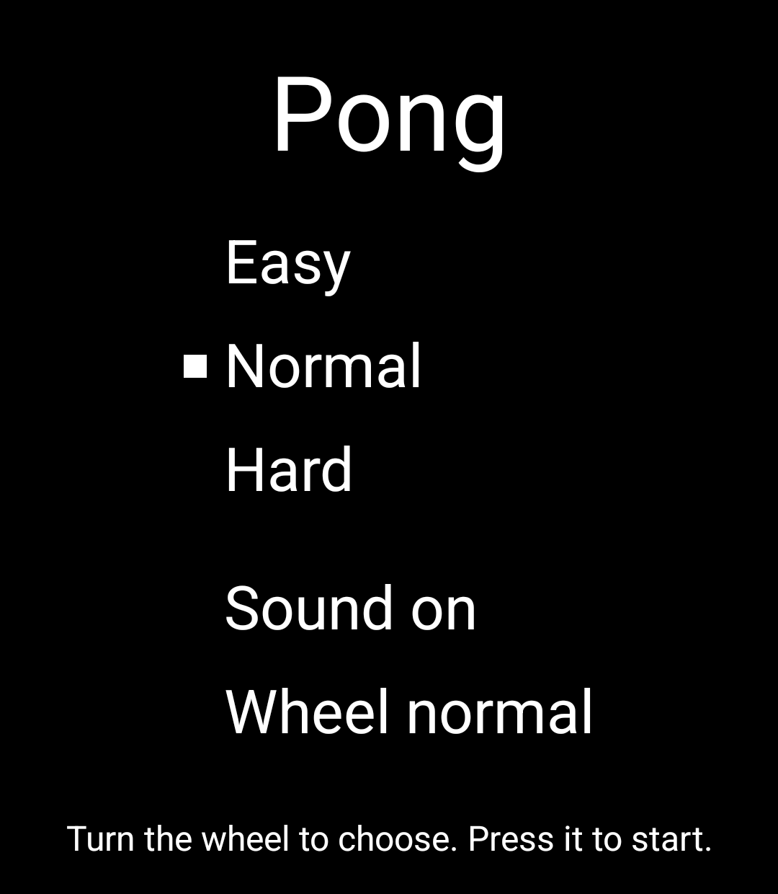
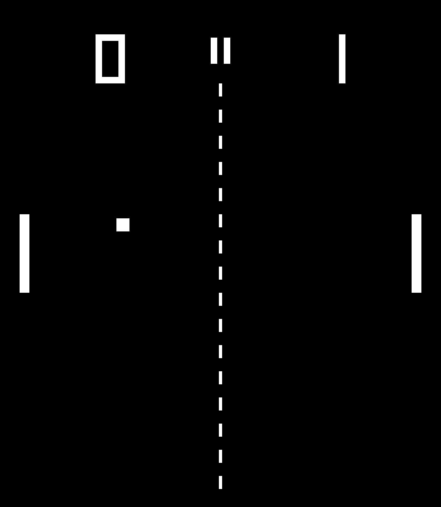
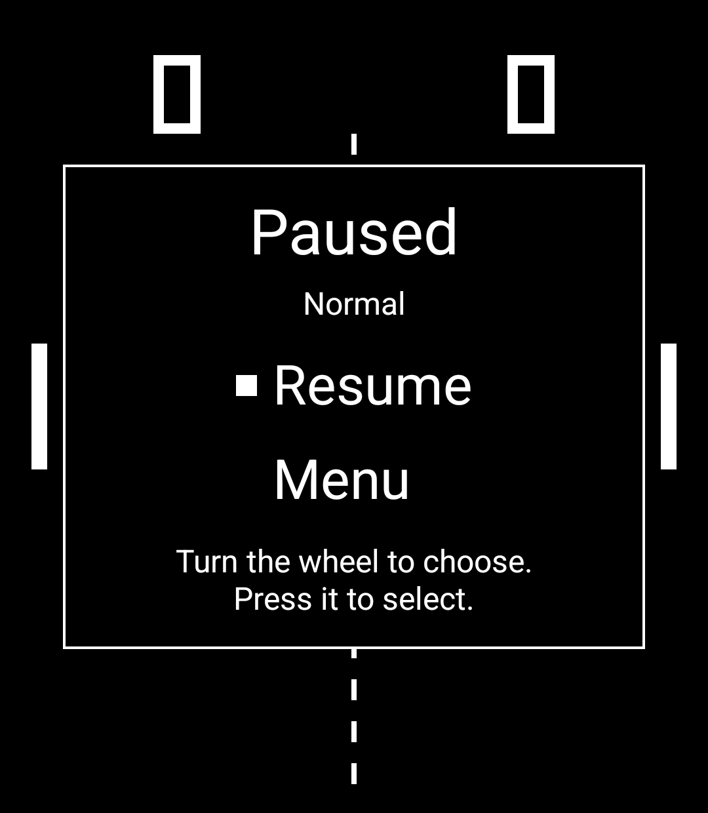

# Pong

Pong for the Light Phone III. You play against the computer, and you move your paddle
with the scroll wheel. The paddle sits on the left, beside the wheel. There is no account, no
network and nothing to set up.

> **Status: 0.1.2. Not yet in Light's Tool Library.** A Light Phone III Tool
> built on [Light's SDK](https://github.com/lightphone/light-sdk).

Questions or bugs: https://github.com/yarosz/light-pong/issues

<p>
  
  
  
</p>

_The title screen, a rally and a paused match. Taken on a Light Phone III._

## How to play

- **Choose a difficulty.** Pong opens on the title screen. Turn the wheel to choose Easy, Normal or
  Hard, and press it to start a match. Normal is the default, and Pong remembers your last choice.
- **Move your paddle.** Turn the wheel. A slow turn moves your paddle a short, even step each click;
  spin faster and each click goes further, up to twice as far.
- **Serve.** Press the wheel. You serve first, then the serve alternates every point. The computer
  serves on its own after a short wait.
- **Pause.** Press the wheel during play. The pause panel offers Resume and Menu. Leaving Pong pauses
  the match too, and so do 60 seconds without input while your serve waits. After Resume, the ball
  waits 0.6 seconds before it moves again.
- **Win.** The first side to 11 points wins, with no win by two. Then choose Play again or Menu.
- **Touch works too.** Drag anywhere to move your paddle, tap to serve, and tap the two bars at the
  top of the field to pause. Tap a row to choose it. Everything also works by wheel alone.
- **Sound.** The sound row on the title screen turns sound on or off. Pong remembers this too. There
  are three short tones (a paddle hit, a wall bounce and a point) and no vibration.
- **Wheel.** The last row on the title screen sets the wheel to normal or fast. Fast moves your paddle
  half as far again for every click. Pong remembers this too.

Back closes Pong. If you come back while the phone still has Pong in memory, your match is waiting,
paused.

## Install

- **From Light's Tool Library**, once Pong is listed there. It is not listed yet.
- **For tinkerers, a dev-signed build over adb.** Your Light Phone III needs developer mode and
  Allowed tools set to "All tools". Build and install it yourself:

  ```sh
  git clone --recursive https://github.com/yarosz/light-pong.git
  cd light-pong
  mise install
  mise exec -- ./gradlew :tool:assembleRelease
  adb install tool/build/outputs/apk/release/tool-release.apk
  ```

  A dev-signed build is signed with the SDK's public development key, not Light's. To move to the
  Light-signed build later, uninstall the dev-signed one first. Uninstalling deletes only your
  difficulty and sound choice.

## Build from source

You need JDK 17 and the Android SDK (API 36). With [mise](https://mise.jdx.dev), `mise install`
provides both, and `mise tasks` lists every command.

```sh
git clone --recursive https://github.com/yarosz/light-pong.git
cd light-pong
mise install
mise exec -- ./gradlew :tool:testDebugUnitTest :tool:assembleDebug
adb install tool/build/outputs/apk/debug/tool-debug.apk
```

A plain `assembleDebug` builds for LightOS on a Light Phone III. For the emulator, run `mise run emu`
to boot it and `mise run tool` to build, install and launch Pong there
(`scripts/emulator/RECIPE.md` sets the emulator up). `mise run light-build` builds the committed
HEAD the way Light's release builder does. `AGENTS.md` describes the layout and how changes land, and
`RELEASING.md` describes how a release is made.

## How it is built

- `DESIGN.md` is the spec: the Field's geometry, the rules and physics, the computer's three
  difficulties, the tones, the input, every screen and every string.
- `CONTEXT.md` is the glossary. The code, the spec and these docs use its terms.
- `docs/adr/` holds the three architecture decisions: the scroll wheel is the control, the game runs
  in a pure deterministic core, and the match lives in a process-wide owner.
- `docs/design/decision-log.md` records every ruling and the contradiction it settled.

The design was settled in three rounds of review by domain-expert agents (rules and feel; controls,
screens and copy; then the contradictions between them). AI agents wrote the code, and each change
was reviewed before it merged. The game core runs on the JVM without Android, so property tests play
hundreds of seeded matches and check the rules after every step.

## Privacy

Pong collects nothing. It declares no permissions and never uses the network. It stores one small
file, `settings.txt`, with your difficulty, whether sound is on and the wheel setting. The full statement is
`docs/privacy.md`; see also `SECURITY.md`.

## Licence

MIT (`LICENSE`). Built on Light's SDK, also MIT.
